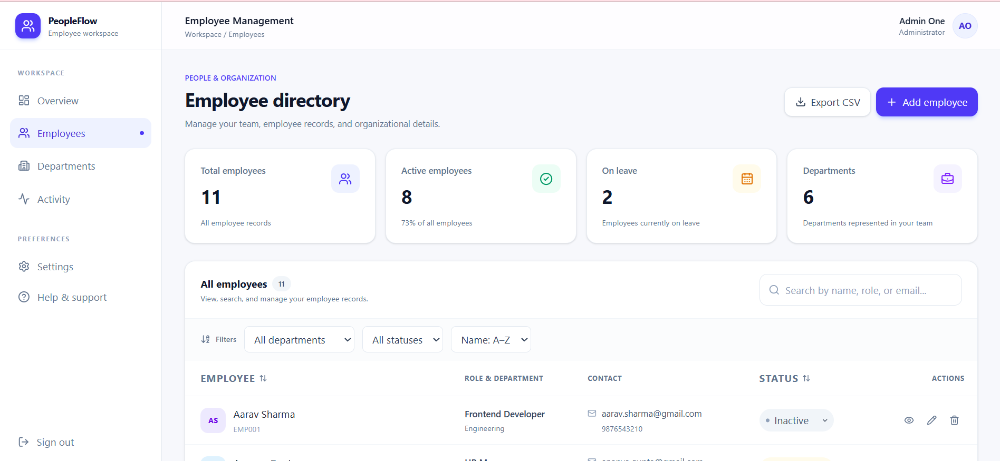
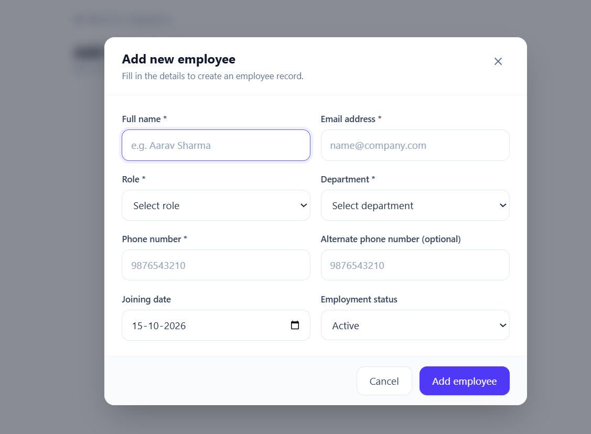
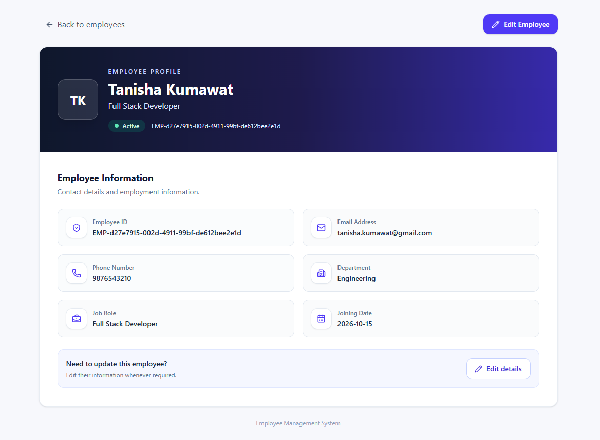

# Employee Management System

A responsive Employee Management System built with **React, Vite, and Tailwind CSS**. The application provides an intuitive dashboard for managing employee records with CRUD operations, search, filtering, sorting, pagination, CSV export, and dedicated employee detail pages.
## Screenshots

### Employee Dashboard


### Add or Edit Employee


### Employee Details

## Project Demo

Watch the complete walkthrough of the Employee Management System, demonstrating its key features and user interface.

**[Watch Employee Management System Demo](https://drive.google.com/file/d/19jVAUZ5fC4RdAyPX9w95Uan1fCsrvJ26/view?usp=drivesdk)**


## Features

- **Dashboard Overview** — View total employees, active employees, employees on leave, and department statistics.
- **View Employees** — Display employee records in a responsive table.
- **Add Employees** — Add new employee records with form validation.
- **Edit Employees** — Update existing employee information.
- **Delete Employees** — Remove employee records with a confirmation dialog.
- **Employee Details** — View individual employee profiles on dedicated detail pages.
- **Status Management** — Change employee status directly from the table using an inline dropdown.
- **Search** — Search employees by name, role, or email.
- **Filtering** — Filter employee records by department and employment status.
- **Sorting** — Sort employee records by name and status.
- **Pagination** — Navigate through employee records with configurable page sizes.
- **LocalStorage Persistence** — Keep employee data saved in the browser between sessions and page refreshes.
- **CSV Export** — Export filtered employee records to a CSV file.
- **Form Validation** — Validate required fields, email formats, and duplicate email addresses.
- **Toast Notifications** — Display feedback for successful operations and errors.
- **Client-Side Routing** — Navigate between the employee directory, add/edit forms, employee details, and a custom 404 page.
- **Reusable Components** — Maintain a modular and organized React component structure.
- **Responsive Design** — Use the dashboard across desktop, tablet, and mobile devices.

## Tech Stack

- **Frontend:** React
- **Build Tool:** Vite
- **Styling:** Tailwind CSS
- **Icons:** Lucide React
- **Language:** JavaScript (ES6+)
- **Routing:** React Router
- **State Management:** React Context API and React Hooks
- **Data Persistence:** Browser LocalStorage
- **Export:** CSV

## Getting Started

### Prerequisites

Make sure you have the following installed:

- [Node.js](https://nodejs.org/)
- npm (included with Node.js)

### Installation

1. Clone the repository:

   git clone https://github.com/tanishakumawat/employee-management-system.git

2. Navigate to the project directory:

   cd employee-management-system

3. Install the dependencies:

   npm install

4. Start the development server:

   npm run dev

5. Open the local URL displayed in your terminal.

## Application Routes

| Route | Description |
|---|---|
| `/` | Redirects to the employee directory |
| `/employees` | View and manage employee records |
| `/employees/new` | Add a new employee |
| `/employees/:id` | View employee details |
| `/employees/:id/edit` | Edit an existing employee |
| Unknown routes | Display the custom 404 page |

## Data Storage

The application uses a predefined JavaScript employee dataset and browser LocalStorage to manage employee records. Employee changes, including additions, edits, deletions, and status updates, are persisted locally without requiring a backend server or database.

**Note:** LocalStorage data is specific to the browser and origin being used. Clearing browser storage may remove saved employee records. This application does not currently synchronize data across browsers or devices.

## Project Structure

```
src/
├── components/
│   ├── Avatar.jsx
│   ├── DashboardHeader.jsx
│   ├── DashboardStats.jsx
│   ├── DeleteConfirmation.jsx
│   ├── EmployeeModal.jsx
│   ├── EmployeeTable.jsx
│   ├── EmployeeToolbar.jsx
│   ├── Pagination.jsx
│   ├── SearchBar.jsx
│   ├── Sidebar.jsx
│   └── StatCard.jsx
├── context/
│   └── EmployeeContext.jsx
├── data/
│   └── employees.js
├── hooks/
│   └── useEmployeeStats.js
├── pages/
│   ├── EmployeesPage.jsx
│   ├── EmployeeFormPage.jsx
│   ├── EmployeeDetailsPage.jsx
│   └── NotFoundPage.jsx
├── App.jsx
└── main.jsx
```

## Future Improvements

- Add authentication and role-based access control.
- Integrate a backend API and database.
- Add automated unit and integration tests.
- Implement advanced reporting and analytics.
- Add bulk employee operations and additional export formats.

## Author

**Tanisha Kumawat**

Frontend Developer | Full Stack Developer
